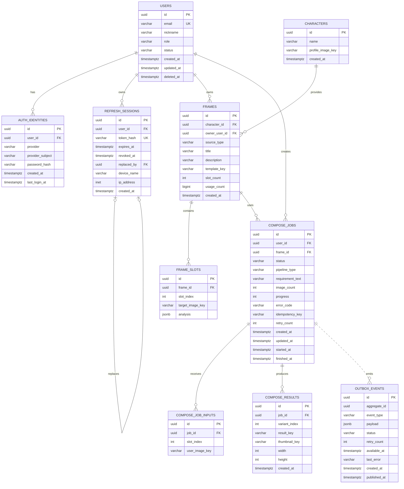

# OurCut 데이터베이스 ERD

OurCut 백엔드의 인증, 캐릭터 프레임, 이미지 합성 작업, 결과물 저장 구조를 표현한 문서입니다.

## ERD



## 도메인별 역할

| 영역 | 테이블 | 역할 |
| --- | --- | --- |
| 사용자·인증 | `users` | 사용자 계정, 역할, 상태 관리 |
| 사용자·인증 | `auth_identities` | 이메일/소셜 로그인 식별자와 인증 정보 관리 |
| 사용자·인증 | `refresh_sessions` | 기기별 refresh token 세션과 폐기·교체 이력 관리 |
| 프레임 | `characters` | 공식 캐릭터 정보 관리 |
| 프레임 | `frames` | 공식 프레임과 사용자 프레임의 공통 모델 |
| 프레임 | `frame_slots` | 프레임에 필요한 슬롯 이미지와 분석 정보 관리 |
| 합성 작업 | `compose_jobs` | 합성 요청의 상태, 파이프라인, 진행률 관리 |
| 합성 작업 | `compose_job_inputs` | 사용자가 업로드한 입력 이미지와 슬롯 매핑 |
| 결과물 | `compose_results` | 합성 완료 이미지와 썸네일 정보 관리 |

## 핵심 설계 포인트

### 공식 프레임과 사용자 프레임의 통합

`frames`는 두 종류의 프레임을 하나의 테이블에서 관리합니다.

- `source_type = CHARACTER`: `character_id`가 필수이고 `owner_user_id`는 비어 있음
- `source_type = USER_UPLOADED`: `owner_user_id`가 필수이고 `character_id`는 비어 있음

이 규칙은 `ck_frames_owner` 제약조건으로 데이터베이스에서도 보장됩니다.

### 작업 입력의 슬롯 매핑

하나의 `compose_job`은 여러 개의 `compose_job_inputs`를 가질 수 있습니다. `(job_id, slot_index)`에 unique 제약을 적용해 하나의 슬롯에 입력 이미지가 중복 연결되지 않도록 했습니다.

### 작업 결과의 variant 관리

하나의 합성 작업은 최대 여러 결과 variant를 가질 수 있습니다. `(job_id, variant_index)` unique 제약으로 동일 작업 내 variant 번호 중복을 방지합니다.

### Idempotency 보장

`compose_jobs`에 `(user_id, idempotency_key)` unique 제약을 적용했습니다. 네트워크 재시도나 사용자의 중복 요청이 발생해도 동일 사용자의 동일 요청이 여러 작업으로 생성되지 않습니다.

### Outbox와 합성 요청 발행

합성 작업과 Outbox 이벤트는 같은 트랜잭션에서 저장됩니다.

```text
compose_jobs 저장
      │
      └── outbox_events 저장
              │
              └── OutboxRelay가 Kafka compose.request로 발행
```

`outbox_events.aggregate_id`는 여러 aggregate 유형을 지원하기 위해 물리적 FK 없이 애플리케이션 레벨에서 `compose_jobs.id`와 연결됩니다.

## 합성 작업 데이터 흐름

```text
USERS
  │
  └── COMPOSE_JOBS ─── FRAMES ─── FRAME_SLOTS
          │
          ├── COMPOSE_JOB_INPUTS
          │
          └── COMPOSE_RESULTS
```

1. 사용자가 프레임과 입력 이미지를 선택합니다.
2. `compose_jobs`에 합성 작업을 생성합니다.
3. 입력 이미지는 `compose_job_inputs`에 슬롯별로 저장합니다.
4. Outbox 이벤트가 Kafka 합성 요청으로 발행됩니다.
5. 합성 완료 callback을 통해 `compose_results`가 저장됩니다.
6. 갤러리 API는 사용자의 완료된 작업과 결과물을 조회합니다.

## 무결성 보장 전략

- 모든 주요 식별자는 UUID를 사용합니다.
- 사용자·프레임·작업·결과 간 핵심 관계는 Foreign Key로 보장합니다.
- 프레임 종류, 작업 상태, 파이프라인 타입은 CHECK 제약조건으로 제한합니다.
- 슬롯 번호, 진행률, 이미지 개수, variant 번호에 범위 제약을 둡니다.
- 프레임 슬롯과 작업 입력은 부모 삭제 시 함께 삭제되도록 `ON DELETE CASCADE`를 사용합니다.
- 비밀번호는 평문이 아닌 해시로 저장합니다.
- refresh token 원문은 저장하지 않고 SHA-256 해시만 저장합니다.

## 마이그레이션

스키마는 Flyway로 관리합니다.

| 버전 | 내용 |
| --- | --- |
| V1 | 인증·사용자·refresh session 테이블 생성 |
| V2 | 사용자 역할 추가 |
| V3 | 캐릭터·프레임·합성 작업·Outbox 테이블 생성 |
| V4 | 공식 캐릭터 및 프레임 초기 데이터 추가 |
| V5 | Outbox 재시도 메타데이터 추가 |
