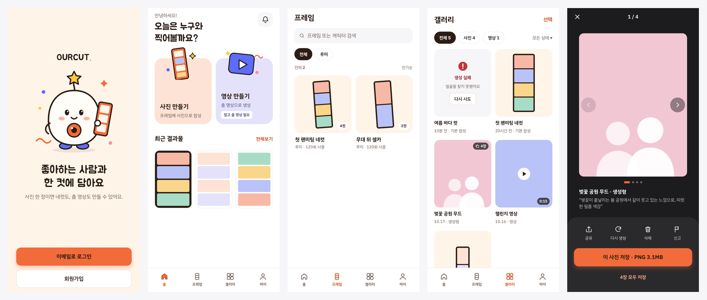
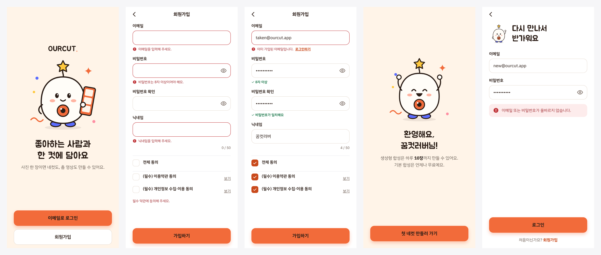
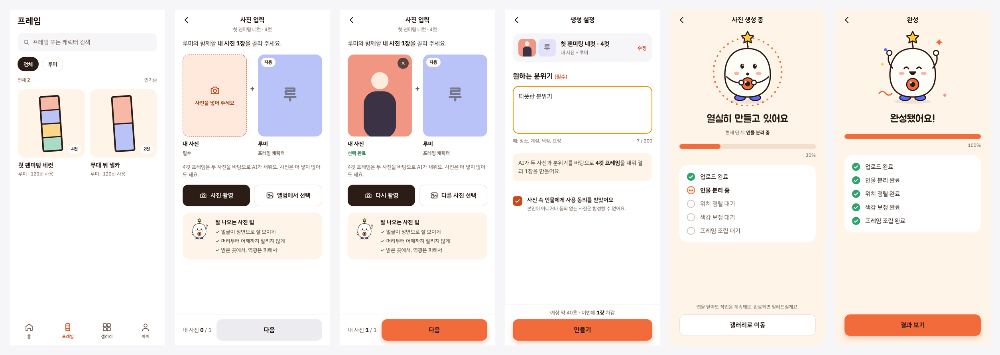
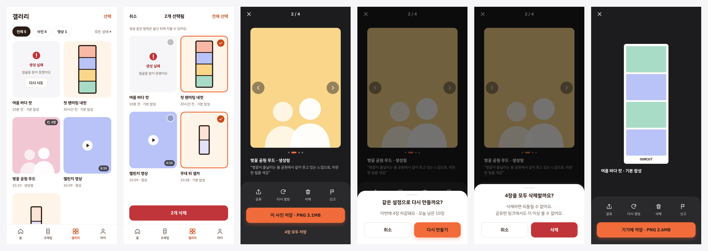

# OURCUT Mobile

좋아하는 사람과 한 컷에 담는 AI 네컷 합성 앱의 모바일 화면입니다.



## 사용자 흐름

```text
첫 화면 ─┬─ 로그인 ──────────────┐
         └─ 회원가입 → 가입 완료 ─┴→ 홈
                                      │
          ┌───────────────────────────┘
          ▼
   프레임 선택 → 내 사진 1장 → 분위기 입력 → 생성 진행 → 결과 상세
                                                        │
                                  갤러리 (다시 보기 · 삭제) ◀┘
```

## 회원



첫 화면 → 회원가입 (입력 검증 · 중복 이메일 안내) → 가입 완료 → 로그인 (실패 안내)

## 사진 만들기



프레임 목록 → 사진 입력 (내 사진 선택 전 / 후) → 생성 설정 → 생성 진행 → 완성

- **프레임**: 캐릭터별 공식 프레임만 제공
- **사진 입력**: 내 사진 1장만 고르면 되고, 캐릭터 이미지는 프레임의 것을 자동으로 사용
- **생성 설정**: 원하는 분위기를 글로 적으면(필수) AI가 프레임 컷 수에 맞춰 결과 1장을 생성

## 갤러리 · 결과



갤러리 → 선택 삭제 → 결과 상세 (여러 장 넘기기) → 다시 생성 확인 → 삭제 확인 → 결과 상세
